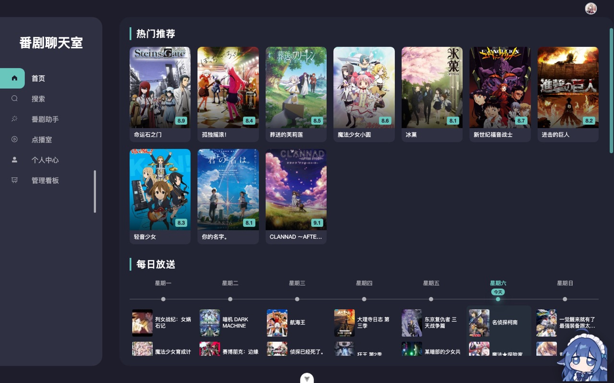
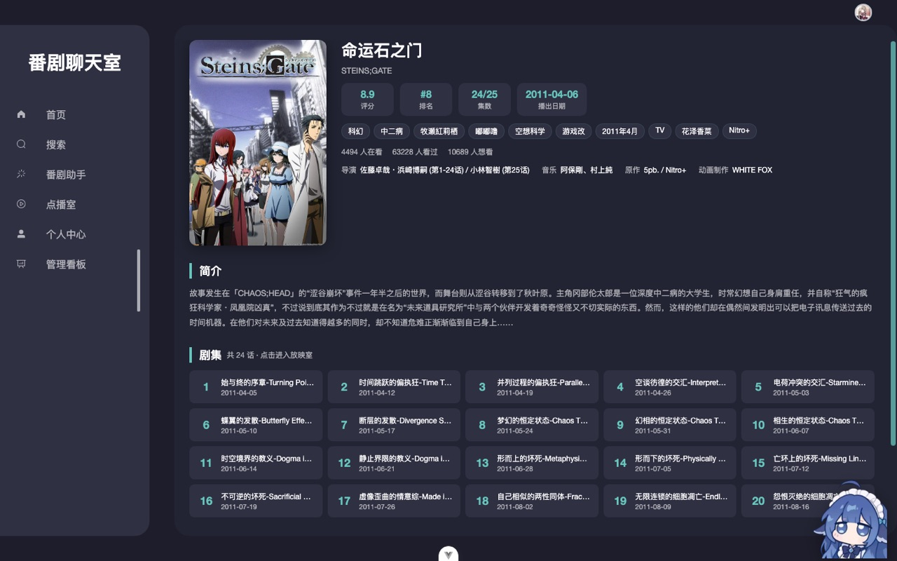
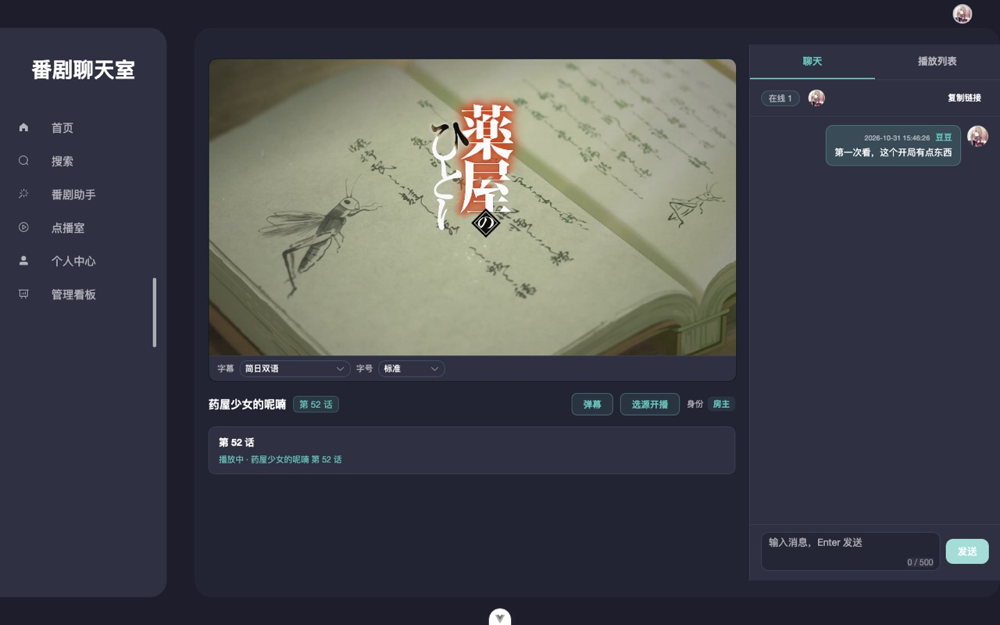
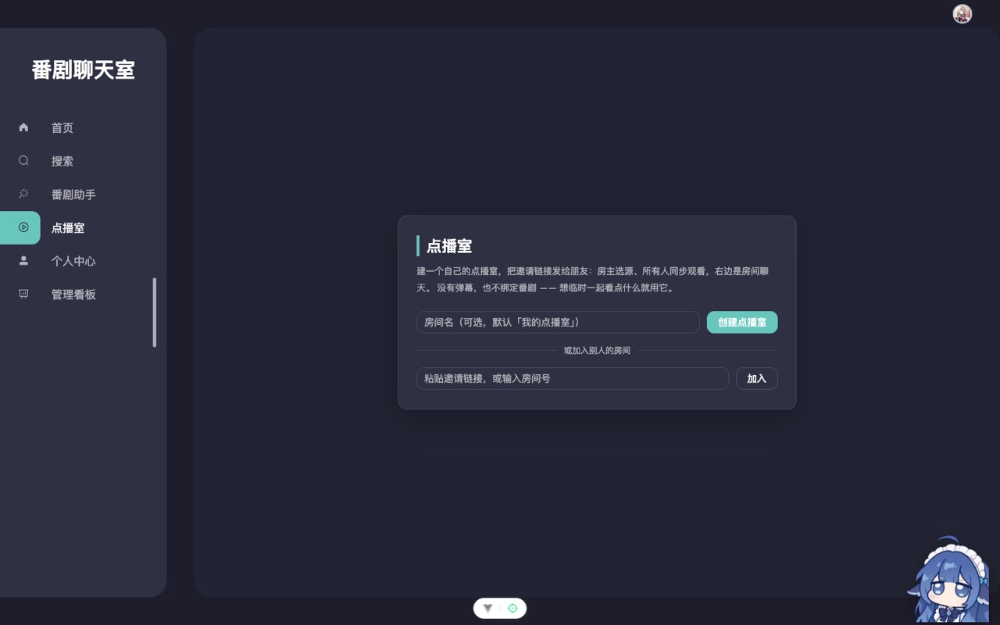
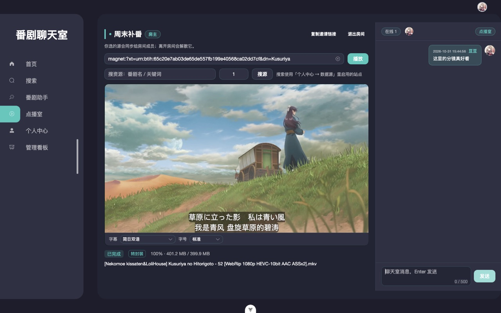
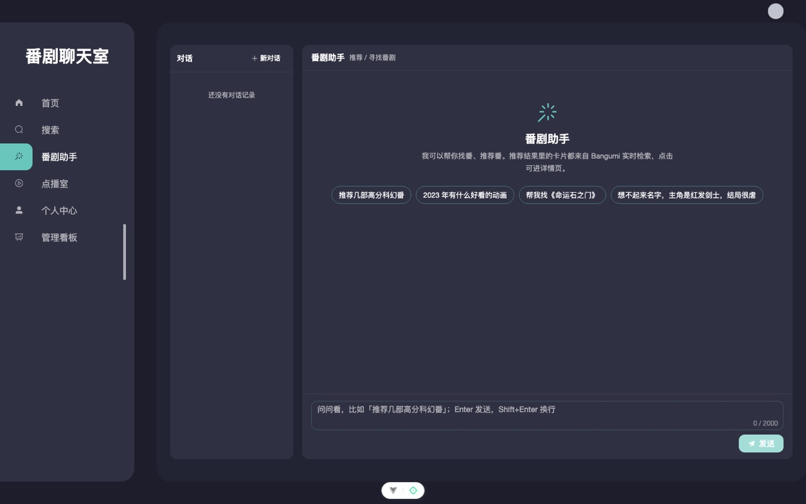
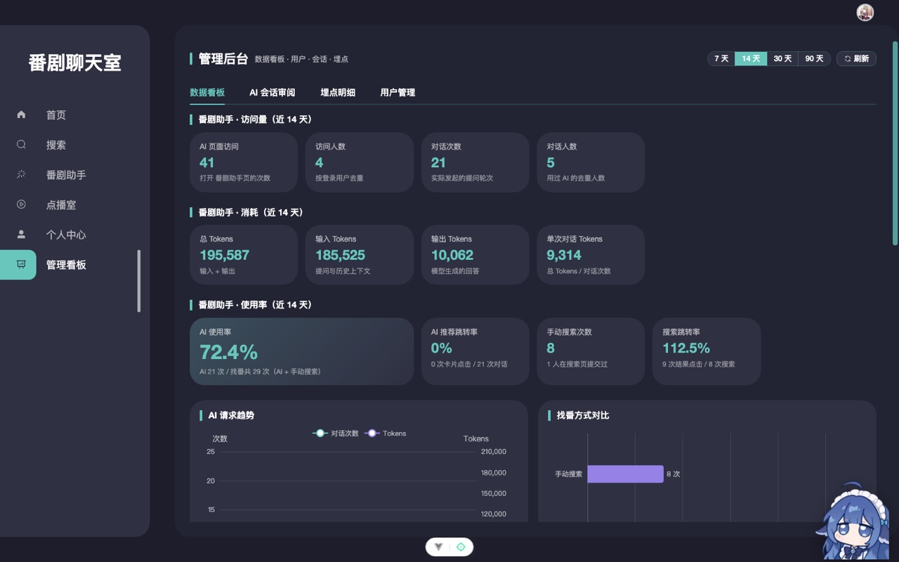

<div align="center">

**动漫放映室（anime-chat）** — 番剧浏览、一起看、私人点播室与磁力边下边播

[](https://vuejs.org/)
[](https://nestjs.com/)
[](https://www.typescriptlang.org/)
[](https://www.mysql.com/)
[](https://socket.io/)
[](https://www.qbittorrent.org/)
[](https://ffmpeg.org/)

</div>

---

## 项目介绍

「动漫放映室」是一个面向小圈子的**一起看番**平台：番剧数据来自 Bangumi，支持追番、数据源订阅，
以及两种完全不同的观影房间 —— 按番剧公开的**放映室**（房主选源、全员强同步、带弹幕）和
凭邀请链接进入的**点播室**（私人房间、房主选源、成员只读跟随、无弹幕）。

播放侧支持流媒体直链代理、BT 磁力的**边下边播**，以及 mkv / HEVC 资源经 ffmpeg
按需转成 **HLS 分片**播放（有真实时长、可拖进度）；内嵌字幕会转成 WebVTT 并提供字号调节。
AI 助手（独立服务 `anime-ai`）负责找番与推荐，管理后台基于全链路埋点做数据看板。

## 效果展示

### 首页与番剧库





### 放映室（一起看）

房主选源开播，所有成员强制同步播放/暂停/进度，右侧实时聊天，弹幕按番剧与集数加载。



### 点播室（私人房间）

不绑定番剧、不进公开列表：建房后把邀请链接发出去，房主选源、成员同步观看，房间内聊天。





### AI 助手与管理后台





## 技术栈

### 前端

| 技术 | 说明 |
| --- | --- |
| Vue 3.5 + Vite 5.4 | 组合式 API、`<script setup>`、按需引入 |
| TypeScript 5.8 | 全量类型覆盖 |
| Pinia | 登录态、番剧数据、放映室/点播室状态、AI 对话 |
| Vue Router 4 | 全部路由懒加载 |
| Element Plus | 组件与主题令牌（深色主题） |
| Artplayer + hls.js | 播放器与 HLS 分片；弹幕用 `artplayer-plugin-danmuku` |
| socket.io-client | 放映室 / 点播室的房间、同步播放与聊天 |
| Less | 样式与主题变量 |

### 后端

| 技术 | 说明 |
| --- | --- |
| NestJS 9 | 模块化后端，全局 `/api` 前缀 |
| TypeORM 0.2 + MySQL 8 | 业务数据；dev `synchronize`，生产用 `docs/schema.sql` |
| JWT 双 token | accessToken 2h + refreshToken 30d，落库轮换/吊销、静默刷新 |
| Socket.IO 4 | 进房、`playback:state` / `playback:control` 强同步、聊天、房主转让 |
| MinIO | 头像对象存储（私有桶 + 代理出图） |
| qBittorrent Web API | 磁力加种、顺序下载、只下选中文件 |
| ffmpeg / ffprobe | HLS 分片转码、内嵌字幕转 VTT |
| Bangumi API | 番剧检索、详情、每日放送（浏览器直连） |
| dandanplay | 弹幕数据（服务端签名，Secret 不下发） |

**几个选型说明**

- **为什么 BT 走 qBittorrent 而不是浏览器 WebTorrent**：番剧磁力普遍依赖 UDP tracker/DHT，
  浏览器 WebRTC 网络覆盖差；qB 负责下载与保种，服务端只按已下载区间出流。
- **为什么 mkv/HEVC 用 HLS 分片**：单条 fragmented mp4 没有索引，浏览器拿不到总时长也不能 seek；
  m3u8 一次给出全部 `EXTINF`，播放器就能显示真实时长并拖动，分片按需转码、命中缓存。
- **为什么 AI 独立仓库**：`anime-ai`（Spring Boot + LangChain4j）用 Java 生态做 RAG 与模型编排，
  与本仓通过 HTTP + SSE 解耦，各自发版互不影响。

## 功能特性

### 番剧浏览与搜索

- 首页热门推荐、每日放送、最近更新；Bangumi 数据直连浏览器
- 番剧详情：评分 / 排名 / 集数 / 标签 / 简介 / 剧集列表
- 搜索页支持排序、类型/设定/角色/地区/情感筛选（Bangumi 检索）

### 放映室（一起看）

- 按番剧 + 集数公开列房，房主选源开播，全员强制同步（播放 / 暂停 / seek / 切集）
- 观众只读跟随；房主离开自动转让给最早加入者，空房即销毁
- 弹幕按「番剧标题 + 集号」加载，控制栏可开关；聊天与在线头像
- 播放列表、选源抽屉（逐站点状态）、自动选源与失败换源

### 点播室（私人房间）

- 入口页创建房间（可命名）或粘贴邀请链接/房间号加入；房间 key 随机 16 位
- **不绑定番剧、不进公开列表**；房主离开房间即解散（成员收到提示）
- 房主粘贴磁力/直链，或按关键词搜源；成员只读同步，不加载弹幕
- 房间内聊天、在线成员，邀请链接一键复制

### 播放能力：边下边播 / HLS / 字幕

- **BT 边下边播**：会话先返回、metadata 后台补齐；qB 顺序下载，服务端按「已下载字节」裁剪
  Range，缓冲不足返回 503，播放器自动重试
- **mkv / HEVC**：ffmpeg 精确 seek 分段转码成 HLS 分片（`-copyts` 保证时间戳连续），
  首次播放/拖动时转码并缓存，进度条显示真实时长、可任意跳转
- **内嵌字幕**：ASS/SRT 轨转 WebVTT（双语同刻 cue 合并成多行），播放器内切换轨道、关闭，
  字号 4 档（60/80/100/120%）持久化
- 流媒体直链：Range 代理、m3u8 相对 URI 改写与同源分片/密钥代理

### 追番与数据源

- 追番（想看 / 在看 / 看完），详情页一键标记；放映室看到第几集自动同步进度
- Animeko 格式数据源订阅（只存 URL，解析在浏览器），支持多站点搜源与启用/停用
- 最近播放记录（localStorage）

### AI 助手

- 独立服务 `anime-ai`：SSE 流式对话、找番/推荐工具调用、RAG 知识库
- 首页右侧悬浮气泡快速提问，或进 `/ai` 完整对话；未登录只渲染引导、不发请求

### 管理后台与埋点

- 仅 `role = root` 可访问：数据看板（访问量 / Tokens 消耗 / AI 使用率 / 趋势图）、
  用户管理（封禁、改角色、重置密码、级联删号 + 审计）、AI 会话审阅、埋点明细与导出
- 前后端埋点写入同一张 `track_event` 表，事件中文名映射在前端常量表维护

## 快速开始

### 环境要求

| 依赖 | 版本 / 说明 |
| --- | --- |
| Node.js | ≥ 18（本机验证 24） |
| pnpm | ≥ 9（本机验证 11） |
| MySQL | 8.x，库名 `anime_chat` |
| MinIO | 头像存储（可选，未配置时头像上传不可用） |
| qBittorrent | 5.x，Docker 一键启动即可 |
| ffmpeg | mkv/HEVC 转码与字幕提取需要 |

### 安装与启动

```bash
git clone https://github.com/Amenoe/anime-chat.git
cd anime-chat

pnpm --dir client install
pnpm --dir server install

# 终端 1：后端（localhost:3000）
pnpm --dir server start:dev

# 终端 2：前端（localhost:8012，/api 代理到 3000）
pnpm --dir client dev
```

浏览器打开 <http://localhost:8012/dev/>。首次使用需注册账号；管理后台需要在库里把
`user.role` 改成 `root`。

### 启动 qBittorrent（BT 播放）

```bash
cd server
mkdir -p data/bt-downloads
docker compose -f docker-compose.playback.yml up -d
docker logs anime-chat-qbittorrent 2>&1 | grep "temporary password"   # 首次启动的临时密码
```

在 `server/.env.development` 里配置：

```env
QB_ENABLED=true
QB_URL=http://127.0.0.1:8085
QB_USERNAME=admin
QB_PASSWORD=你的密码
QB_DOWNLOAD_PATH=<仓库绝对路径>/server/data/bt-downloads   # 必须与 compose 卷一致
```

### ffmpeg（mkv / HEVC 必需）

```bash
brew install ffmpeg        # macOS
# 或 apt install ffmpeg   # Debian/Ubuntu
```

不在 PATH 时用 `FFMPEG_PATH` / `FFPROBE_PATH` 指定；不需要该能力可设 `PLAYBACK_TRANSCODE=false`。

### 环境变量

前端见 `client/.env.development`（`VITE_SERVE_URL` / `VITE_BASE_API` 等），
后端见 `server/.env.development`：

| 变量 | 说明 |
| --- | --- |
| `DB_*` | MySQL 连接 |
| `JWT_SECRET` / `JWT_REFRESH_SECRET` | 双 token 签名密钥 |
| `MINIO_*` | 头像对象存储 |
| `QB_*` | qBittorrent 连接与下载目录 |
| `FFMPEG_PATH` / `PLAYBACK_TRANSCODE` / `PLAYBACK_HLS_*` | 转码、HLS 分片与缓存 |
| `AI_SERVICE_URL` / `AI_INTERNAL_TOKEN` | 转发到 `anime-ai` |
| `DANDANPLAY_*` | 弹幕开放平台签名凭证（仅服务端） |

## 项目结构

```
anime-chat/
├── client/                  # 前端（Vue 3 + Vite）
│   ├── src/api/             # 接口封装（Bangumi / 业务后端）
│   ├── src/components/      # 播放器、放映室、点播室、聊天面板
│   ├── src/stores/          # login / home / room / vod / ai / route
│   ├── src/views/           # 首页、搜索、详情、放映室、点播室、AI、后台
│   └── src/router/          # 路由（全部懒加载）
├── server/                  # 后端（NestJS）
│   ├── src/auth|user|user-anime|room|chat|playback|media-source|storage|track|admin
│   ├── src/playback/        # 播放会话、qB、HLS 分片、字幕、搜源
│   ├── scripts/             # auth-e2e / admin-e2e 验收脚本
│   └── docker-compose.playback.yml
├── docs/                    # 架构、接口契约、播放方案、任务看板
└── package.json             # 根脚本（dev/build/typecheck）
```

## 文档

- [项目记忆与任务看板](docs/PROJECT_MEMORY.md)
- [接口契约](docs/api-contract.md)
- [前后端认知同步](docs/COGNITION_SYNC.md)
- [播放架构（BT / HLS / 字幕）](docs/playback-architecture.md)

## 版本

当前版本 **v1.0.0**（首个单仓版本，合并原 `anime-chat` 前端、`anime-chat-server` 后端与 `docs` 文档）。

## 致谢

- 番剧数据：[Bangumi](https://bgm.tv/)
- 弹幕数据：[dandanplay](https://doc.dandanplay.com/open/)
- 播放器：[Artplayer](https://artplayer.org/)、[hls.js](https://github.com/video-dev/hls.js)
- BT 下载：[qBittorrent](https://www.qbittorrent.org/)
- 转码与字幕：[FFmpeg](https://ffmpeg.org/)
